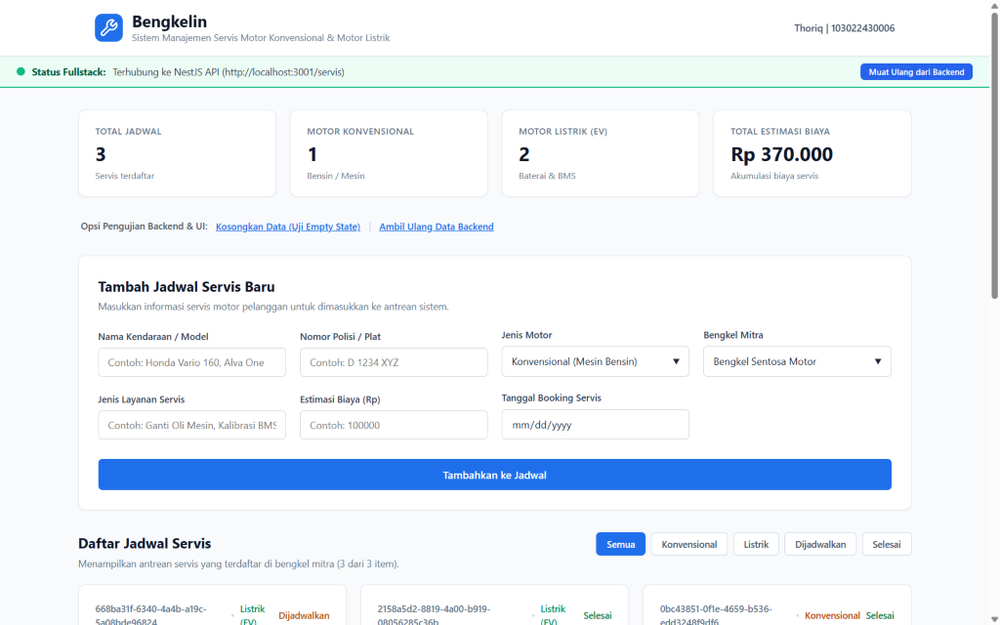
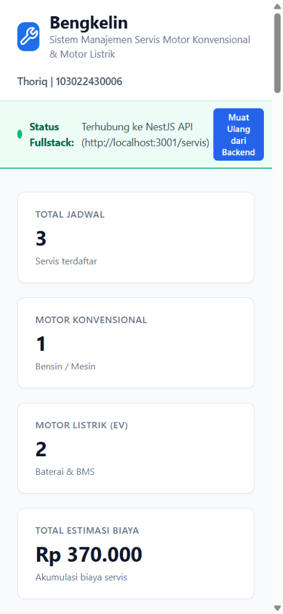
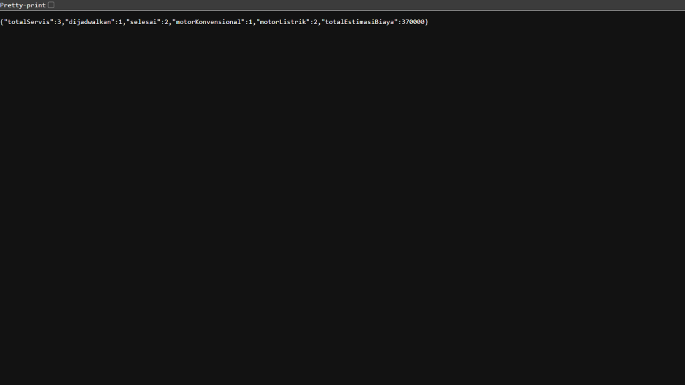
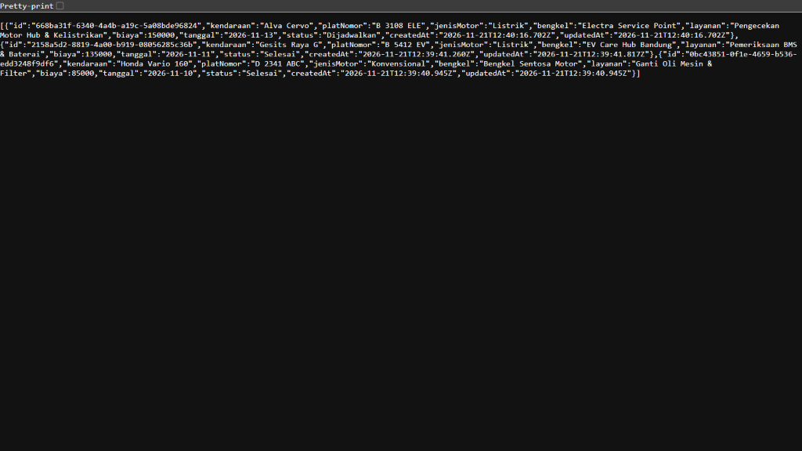

## Informasi Mahasiswa & Proyek

- **Nama Lengkap:** Thoriq Abdurrohman Taqy
- **NIM:** 103022430006
- **Kelas:** SE-48-04
- **Program Studi:** S1 Rekayasa Perangkat Lunak (Software Engineering)
- **Mata Kuliah:** Perancangan dan Pemrograman Web (CCK3DAB3)
- **Nama Aplikasi:** **Bengkelin** (Sistem Manajemen Servis Motor Konvensional & Motor Listrik)
- **Repositori GitHub:** [https://github.com/Thbetyfu/PENGWEB-Week-10](https://github.com/Thbetyfu/PENGWEB-Week-10)

---

# Bengkelin Fullstack Monorepo (NestJS + PostgreSQL + Prisma ORM + React)

penggunaan AI :

1. gemini untuk membuat readme.md saja dan dokumentasi

Bengkelin adalah aplikasi web untuk mengelola antrean pemesanan jadwal servis, estimasi biaya, pemilihan bengkel mitra, dan riwayat perawatan berkala sepeda motor bermesin konvensional maupun motor listrik (*Electric Vehicle / EV*).

Pada Tugas Perkuliahan Pekan 10, backend RESTful API NestJS telah dihubungkan ke basis data relasional PostgreSQL menggunakan Prisma ORM melalui `PrismaService` dan `PrismaModule` (menggantikan penyimpanan *in-memory array* dari Pekan 9) sehingga seluruh data CRUD tersimpan secara permanen.

> **Catatan Pembersihan Kode (Inisiatif Pribadi - Week 10):**
> Pada repositori Week 10 ini, seluruh *dead code*, aset template yang tidak terpakai, serta arsip file/screenshot lama dari Week 1 hingga Week 9 telah dihapus atas **inisiatif pribadi** (meskipun tidak diminta secara eksplisit dalam instruksi soal). Hal ini dilakukan karena penumpukan berkas dari pekan-pekan sebelumnya membuat struktur proyek membingungkan dan sulit dipahami saat fokus mengerjakan implementasi PostgreSQL & Prisma ORM di Week 10.

---

## Struktur Direktori Proyek

```text
PENGWEB-Week-10/
├── backend/                        # [BE] NestJS + Prisma ORM + PostgreSQL (Port 3001)
│   ├── prisma/
│   │   ├── migrations/             # Riwayat migrasi DDL PostgreSQL
│   │   └── schema.prisma           # Model Servis, enum JenisMotor & StatusServis
│   ├── src/
│   │   ├── prisma/
│   │   │   ├── prisma.module.ts    # Modul global Prisma
│   │   │   └── prisma.service.ts   # Provider koneksi PrismaClient (OnModuleInit)
│   │   ├── servis/
│   │   │   ├── dto/                # Validasi input (class-validator)
│   │   │   ├── servis.controller.ts
│   │   │   ├── servis.module.ts
│   │   │   └── servis.service.ts   # Operasi CRUD & Statistik via Prisma Client
│   │   ├── app.module.ts
│   │   └── main.ts                 # Bootstrap, CORS, dan ValidationPipe global
│   ├── .env.example                # Template variabel environment DATABASE_URL
│   ├── package.json
│   └── servis.http                 # Skrip pengujian REST Client
│
├── frontend/                       # [FE] React 19 + Vite (Port 5173)
│   ├── public/
│   │   └── favicon.svg
│   └── src/
│       ├── components/             # Komponen UI modular
│       ├── data/                   # Helper formatRupiah & fallback offline
│       ├── services/api.js         # Fetch API ke Backend NestJS & DummyJSON
│       ├── App.jsx
│       ├── App.css
│       ├── index.css
│       └── main.jsx
│
├── docs/
│   └── screenshots/                # Dokumentasi screenshot Week 10 (Desktop, Mobile, Prisma)
│
├── .gitignore
├── package.json
└── README.md
```

---

## Daftar Endpoint REST API (`/servis`)

| Method     | Endpoint              | Deskripsi                                                                                                                              |
| :--------- | :-------------------- | :------------------------------------------------------------------------------------------------------------------------------------- |
| `GET`    | `/servis`           | Mengambil seluruh daftar servis (mendukung query `?status=` & `?jenisMotor=`)                                                      |
| `GET`    | `/servis/statistik` | **Query Lanjutan:** Menghitung total servis, jumlah per status/jenis motor (`count`), dan total estimasi biaya (`aggregate`) |
| `GET`    | `/servis/:id`       | Mengambil detail 1 data servis berdasarkan UUID                                                                                        |
| `POST`   | `/servis`           | Menambahkan jadwal servis baru ke PostgreSQL (validasi DTO + cek duplikat `409 Conflict`)                                            |
| `PATCH`  | `/servis/:id`       | Memperbarui data/status servis secara parsial di PostgreSQL                                                                            |
| `DELETE` | `/servis/:id`       | Menghapus data servis secara permanen dari PostgreSQL                                                                                  |

---

## Cara Menjalankan Proyek Secara Lokal

### 1. Persiapan Backend & Database PostgreSQL

```bash
cd backend
npm install --legacy-peer-deps
cp .env.example .env   # Sesuaikan DATABASE_URL PostgreSQL lokal Anda
npx prisma migrate dev # Jalankan migrasi tabel servis
npm run start:dev      # Backend berjalan di http://localhost:3001
```

### 2. Menjalankan Frontend React

```bash
cd frontend
npm install
npm run dev            # Frontend berjalan di http://localhost:5173
```

---

## Dokumentasi Screenshot (Week 10)

### 1. Tampilan Desktop Fullstack (Terhubung PostgreSQL via NestJS + Prisma)



### 2. Tampilan Mobile Responsif



### 3. Endpoint Query Lanjutan (`GET /servis/statistik` — Count & Aggregate)



### 4. Endpoint Daftar Servis (`GET /servis` — Data Persisten PostgreSQL)


